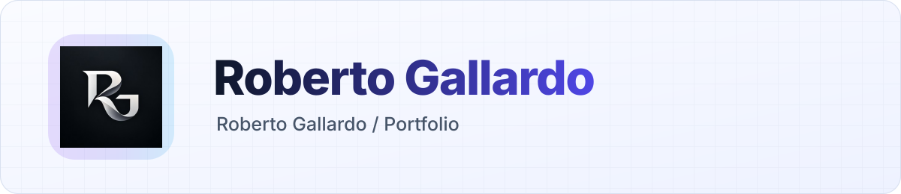

<a id="top"></a>

<h1 align="center">Roberto Gallardo — Portfolio</h1>

<p align="center">The source of my personal portfolio: projects, experience and ways to get in touch, in English and Spanish.</p>

Personal portfolio at [robertogallardo.dev](https://robertogallardo.dev), built with Next.js 16, React 19,
Tailwind CSS 4, Framer Motion and tsParticles. Bilingual (EN/ES) with light and dark themes.

The **View CV** button links to the private résumé at `cv.robertogallardo.dev`
(separate project, password-protected).

## Development

```sh
pnpm install
pnpm dev
pnpm lint
pnpm build
```

- Text and project lists: `app/i18n/locales/en.json` and `es.json`.
- Skills and icons: `components/sections/AboutSection.tsx` (Simple Icons slugs, or `react-icons` for brands Simple
  Icons no longer ships).
- Social preview image: generated by `app/opengraph-image.tsx` / `app/twitter-image.tsx`.

<p align="center"><a href="#top">Back to top</a></p>

<!-- readme-builder:signature:start -->
<p align="center"><a href="https://github.com/robgallardof"><picture><source media="(prefers-color-scheme: dark)" srcset="assets/readme/brand/signature-en-dark.svg" /></picture></a></p>
<!-- readme-builder:signature:end -->
